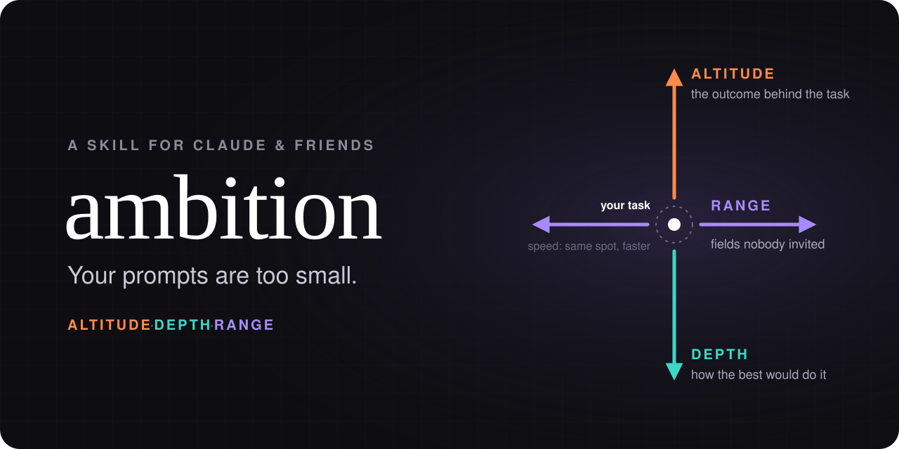

<p align="center">
  
</p>

<p align="center">
  <b>把你"随口一问"的任务，变成你真正做得到的最有野心的版本，然后把它做出来。</b>
</p>

<p align="center">
  <a href="https://agentskills.io"></a>
  <a href="LICENSE"></a>
  <a href="prompt/ambition-prompt.md"></a>
</p>

<p align="center">
  <a href="#安装">安装</a> ·
  <a href="#用前用后">用前用后</a> ·
  <a href="#原理">原理</a> ·
  <a href="#公开测试">测试</a> ·
  <a href="README.md">English</a>
</p>

<p align="center">
  
</p>

大多数人用 AI 是为了**快**：本来就要做的事，做得更快一点。可同样的模型，有人用它让整个 App 保持零崩溃、废掉开了十年的季度汇报、在自己的数据里挖出连老板都不知道的规律。

两拨人用的模型没有差别，差别在于**提的要求**。

`ambition` 做的就是把要求提上去。随便给它一个任务，它会还你一张**野心阶梯**：同一个任务的三个更大胆的版本。每一级都写明需要什么，以及一个**不靠模型自己打分**的验收方式。它还会画出做成之后大概长什么样。你挑一级，它帮你写好提示词，或者直接开干。

## 安装

**任意编程 Agent**：Claude Code、Codex、Cursor、Gemini CLI、GitHub Copilot 等[几十种工具](https://skills.sh)都支持。

```bash
npx skills add ambitionhq/ambition
```

<details>
<summary><b>其他安装方式</b></summary>

**Claude Code 插件**

```bash
/plugin marketplace add ambitionhq/ambition
/plugin install ambition@ambition
```

**手动安装：** 把 `skills/ambition` 复制到你的 Agent 的 skills 目录（Claude Code 是 `~/.claude/skills/`）。

**Claude.ai / Claude 桌面版：** 从 [Releases](../../releases) 下载 `ambition.skill`，在设置的 Skills 里上传。

**ChatGPT、Gemini 或任意聊天机器人：** 把 [`prompt/ambition-prompt.md`](prompt/ambition-prompt.md) 粘贴进自定义指令、GPTs、Gem 或 Project。

</details>

然后试试：

```text
/ambition <你正准备让 AI 做的任何事>
```

## 用前用后

同一个模型，同一个问题：

> *帮我想得更有野心一点：我现在想写个 Python 脚本，每天早上把 Shopify 店铺前一天的订单导出成 Excel，然后邮件发给老板。有没有更厉害的做法？*

**不用 `ambition`：** 一份很用心的建议清单，分三期把报表做成经营简报。

**用了 `ambition`：** 一张三级阶梯。第 1 级是"正文先说变化"；第 2 级（推荐）是"把日报改成预警"；第 3 级是"每小时巡检的值班助手"。接着给出推荐理由、需要解锁的东西、信任风险，还有老板早上 8 点收到的样子：

```text
【昨日经营 · 10/27 周二】⚠ 1 项异常，其余 9 项正常

⚠ 退款率 6.8%（周二正常范围 1.6%–3.9%）
   14 笔退款里有 11 笔来自「羊毛围巾-灰」，其中 8 条退款备注提到"色差"
   这款从 10/21 起退款明显变多，之前 8 周平均退款率 1.2%
   建议：今天先停这款的广告，查一下最近到的这批货

✓ 销售额 $32,033（正常 $27k–$36k）· 订单 206 · 客单价 $155.5
✓ 超 48 小时未发货：0 · 热销款可售天数都在 14 天以上
```

最后是一段可以直接粘贴的提示词：用 API 拉 12 个月原始订单，按星期几建"正常范围"，回测过去的事故（命中 ≥80%、误报 ≤1 次/周），先和旧报表并行跑 4 周。

上面的样例数字是编的。两次运行的**完整原始输出**都在 [`showcase/`](showcase/)，没有删改。

## 原理

用模型"更有野心"有四个方向。第一个是大家的默认方式，真正的杠杆在后三个。

| 方向 | 怎么做 | 例子 |
|---|---|---|
| **速度** Speed | 同样的事，更快做完 | 帮我更快写完这个函数 |
| **高度** Altitude ↑ | 解决任务背后的结果，而不只是任务本身 | *修这个崩溃* → *让 App 保持零崩溃* |
| **深度** Depth ↓ | 像行业顶尖的人那样做：原始数据、专业工具、离谱的目标 | *总结一下工单* → *按根因给 4200 条原始工单分类，并检验大家深信不疑的结论* |
| **广度** Range ↔ | 借用没人想到要请来的领域的方法 | *做个生日视频* → *像档案修复师那样修老照片，像声音设计师那样铺上家人的语音* |

每张阶梯都会走一遍这几步：

1. **第 0 级。** 复述你字面上要的东西，盘点手头已有的资源。
2. **选对方向。** 它知道什么时候*不该*爬，比如创作类任务往"高度"爬会把作品磨平。
3. **搭三级台阶：** 拉伸、大胆、激进。每一级都必须是*结果*更大，马上能动手，有依据，能被外部验收，还要带一个数字。
4. **列出解锁条件**（包括需要谁点头），以及会让人不再信任结果的**信任风险**。
5. **指定外部裁判：** 测试、留出数据、回测、性能分析器、真实用户。
6. **推荐一级，画出做成后的样子，** 交还一份可以直接粘贴的提示词。

## 和"想大一点"这类提示词有什么不同

- **每一级都能马上开始。** 不会出现"利用 AI 赋能业务转型"这种空话。5 分钟内动不了手的，就要重写。
- **模型从不自己给自己打分。** 每条建议都带一个外部验收方式。
- **要方法，不要角色扮演。** 它不会让模型"用做空者的口吻写"，而是让它*像做空者那样干活*：专门去找这个故事站不住脚的证据。
- **先看到，再决定。** 每张阶梯都附一份成品示意：预警消息、幻灯片、故事梗概。
- **诚实说出便宜路线。** 如果现成工具已经能做到第 1 级，它会直说。
- **阶梯是菜单，不是命令。** 它绝不会偷偷扩大你要求的范围，选哪一级由你决定。

## 命令

| 命令 | 作用 |
|---|---|
| `/ambition <任务>` | 阶梯模式：三级台阶、推荐、成品示意和升级后的提示词。不会开始干活。 |
| `/ambition go` | 执行选定的那一级，对照外部裁判验收。先和旧流程并行，有风险的操作会先问你。 |
| `/ambition audit` | 回看这次对话或整个项目，找出你目标定得最低的三个地方。 |
| `/ambition depth <任务>` | 只走一个方向（`altitude` / `depth` / `range`）。 |

不用记命令，直接说也能触发："更有野心一点""想大一点""格局打开""10 倍一下""我漏了什么？"

## 案例

六个领域的完整阶梯示例见 [`examples.md`](skills/ambition/references/examples.md)：

| 领域 | 第 0 级 | 第 3 级 |
|---|---|---|
| 工程 | 修这个崩溃 | 让 App 保持零崩溃（先影子运行） |
| 性能 | 让网站快一点 | CI 性能预算，让"变慢"根本合不进主干 |
| 用户研究 | 总结 20 场访谈 | 按受访者的真实使用数据给观点加权，然后下注 |
| 求职 | 写封求职信 | 像效果广告投放一样做 A/B 测试 |
| 学习 | 做个西班牙语学习计划 | 每天从你自己的错误里生成练习的私教循环 |
| 创作 | 给老爸做个生日视频 | 用 3D 重建他小时候住的那条街 |

**欢迎投稿你的阶梯。** 带真实结果的案例会收进 [gallery](gallery/)，见 [CONTRIBUTING.md](CONTRIBUTING.md)。

## 公开测试

我们用同一个模型，在三个测试任务上对比了"用 skill"和"不用 skill"：中文数据流水线、客服工单复盘、科幻短篇小说。所有输出都由一个独立的评分 Agent 打分。

| 任务 | 通过的检查项（用 / 不用） | 评分者更想收到哪一份 |
|---|---|---|
| 客服工单复盘 | 12/12 · 8/12 | **用了 ambition**：直接能拿去做决策，分析提示词拿来就能跑 |
| Shopify 每日报表（中文） | 13/13 · 10/13 | **用了 ambition**，险胜；不用的那份读起来更亲切 |
| 科幻短篇小说 | 13/13 · 9/13 | **不用**：原生模型给的故事构想更有原创性 |

检查项有一部分在看结构（有没有阶梯、裁判、可粘贴的提示词），所以通过率对 skill 有利。最后一列才是更诚实的结论。每种配置只跑了一次，请把它当作基本验证，而不是严格的基准测试。在 skill 输掉的地方，我们一直在改：第一轮的小说阶梯全是流程，所以才有了"每一级都必须是更大的*结果*"这条规则。全部输出见 [`showcase/`](showcase/)。

前沿模型本身就很会头脑风暴。`ambition` 带来的是稳定的结构：可量化的目标、外部裁判、具体的成品示意、诚实的解锁清单，以及一段能直接执行的提示词。测试用例在 [`evals/`](evals/)，你可以自己跑：

```bash
claude plugin eval .
```

## 常见问题

**这不就是个提示词吗？**
是的，会用模型的人，本事大多也就藏在提示词里。这一个有结构、经过测试，而且专门针对几种常见失败：角色扮演、自己给自己打分、范围蔓延、把"更大"冒充成"更深"。

**它会把每个任务都搞得很大吗？**
不会。阶梯模式不会动手干活。很多时候第 1 级就是最好的答案，它会直说。

**只能配合 Claude 用吗？**
不是。`SKILL.md` 是大多数编程 Agent 都支持的开放标准，[`prompt/ambition-prompt.md`](prompt/ambition-prompt.md) 能用于任何聊天机器人。

**为什么叫 ambition（野心）？**
人会朝着自己相信可能的方向去努力，模仿人类的模型也一样。具体而困难的目标、"已经有人做到过"的先例、允许失败的心态，都能实实在在地提高人们敢尝试的上限。详见 [why-it-works.md](skills/ambition/references/why-it-works.md)。

## 致谢

速度、高度、深度、广度这个四维框架来自 Felix Rieseberg 的文章 [*How to be more ambitious: A tutorial for humans with models*](https://felixrieseberg.com/how-to-be-more-ambitious-a-tutorial-for-humans-with-models)（2026 年 10 月）。强烈推荐读原文，不长，写得非常好。"把名词改写成动词"的技巧出自 Tom Kelley 与 Jonathan Littman 的《创新的艺术》（*The Art of Innovation*）。

这是一个独立的社区项目，与 Anthropic 及原文作者没有隶属关系，也未获其背书。

## 许可证

[MIT](LICENSE)
